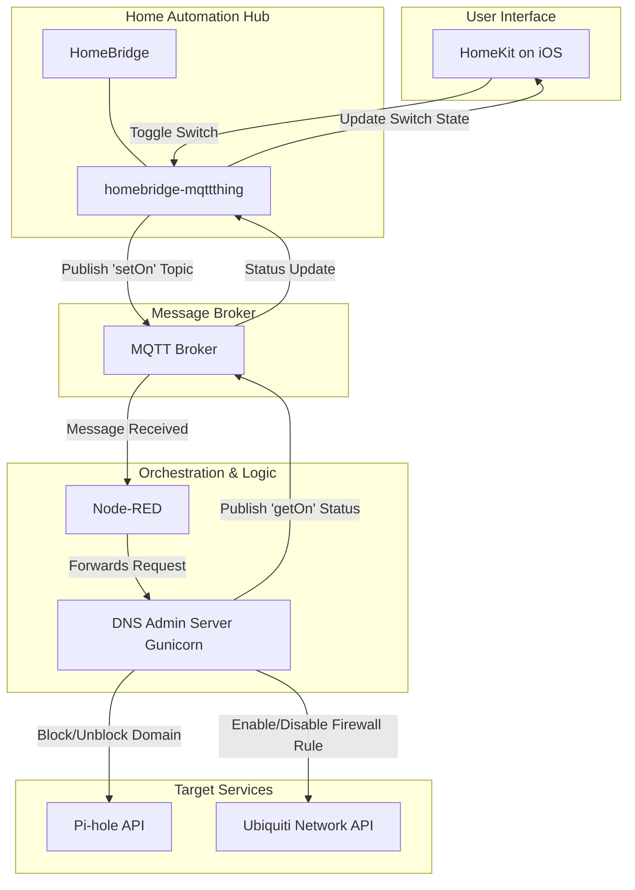

# Home IOT Overlord
## Network Kill Switch for HomeKit
### What is the problem this project is trying to solve?

For iOS Households, this webserver allows one-touch blocking of specific domains (e.g. streaming services) on a per-device basis via HomeKit switches or entire network ranges via Ubiquiti firewall rules. All functionality can be accomplished via the native pihole admin console, but this project aims to simplify the process for non-technical users.

i.e.
*   **Parental Controls:**  Temporarily disable internet access for your children's devices.
*   **Focus Time:**  Block distracting websites while you are working.

### Requires:
 - [Homebridge: MQTT Thing](https://github.com/arachnetech/homebridge-mqttthing)
 - [NodeRed](https://nodered.org/)
 - [Gunicorn](https://gunicorn.org/) / [FastAPI](https://fastapi.tiangolo.com/)
 - [Pihole ](https://pi-hole.net/)
 - [PiHole6API](https://github.com/sbarbett/pihole6api)
 - [Ubiquiti Network Controller](https://www.ui.com/software/)


####
Last Tested:

* Pi-hole v6
* Ubiquiti Control 9.4.19.

#### Disclaimers

 1. Thanks to [sbarbett](https://github.com/sbarbett/) for adding pihole v6 support to pihole-api via [pihole6api](https://github.com/sbarbett/pihole6api) - that drastically simplifies our code base
 1. Design choice: keep node-red focused on transport than the heavy lifting of config management
 1. Design limitation: MQTT Thing doesn't support dynamic accessories currently, so each provider will need


### See Also:
 - [Homebridge - Pihole ](https://github.com/arendruni/homebridge-pihole#readme)


### Container Quickstart

Population of the envfile will allow you to run the default container - but you will need to mount your own config.ini to get the most value from the tool.
```config
DNS_SERVERS=<DNS_SERVER_IP_1>,<DNS_SERVER_IP_2>
REMOTE_PI_PASSWORD=<YOUR_REMOTE_PI_PASSWORD>
REMOTE_PI_LIST="<PI_1> <PI_2> <PI_3>"
MQTT_BROKER=<MQTT_BROKER_IP>
MQTT_PORT=<MQTT_BROKER_PORT>
REMOTE_UBIQUITI_DEVICE=<YOUR_UNIFI_DEVICE_IP>
REMOTE_UBIQUITI_API_KEY=<YOUR_UNIFI_API_KEY>
```

```bash
# Add if needed -v ./etc/config.ini:/opt/webserver/etc/config.ini
podman run -d --replace --name=overlord-dns -p 19000:19000 --env-file=./etc/envfile ghcr.io/nickjlange/overlord-network-kill-switch:latest

```

### Development and checks

Use Python 3.12 and [uv](https://docs.astral.sh/uv/) (CI and container builds use
uv 0.12.9). Private deployment files are optional for development.

```bash
make venv          # Sync .venv from uv.lock, including test dependencies
make check-deps    # Verify the lock and generated requirements are current
make test-unit     # Run the mocked, unit-marked suite in tests/unit
```

`pyproject.toml` is the dependency source of truth; `uv.lock` pins the resolved
versions used locally, in CI, and in the container. The requirements files in
`etc/` are generated exports for pip users. After an intentional dependency edit,
run `uv lock`, `make export-deps`, and `make test-unit`, and commit the manifest,
lock, and both exports together. Use `uv lock --upgrade-package <name>` for a
targeted update that still satisfies the manifest's constraints.

`make full` builds with Podman. If `etc/config.ini` does not exist, it copies
`private/etc/config.ini` when available, otherwise `etc/config.ini.sample`.
Existing `etc/config.ini` files are preserved; review the configuration before
running a container. Mount deployment configuration at runtime rather than
baking credentials into an image intended for publication.

`make test-integration` requires Docker Engine and Compose v2 with `up --wait`
support. It builds a disposable Pi-hole/Overlord stack, waits for health checks,
runs `tests/integration`, and removes the stack and its test volumes even if a
test fails. Ports 8080, 5353, and 19000 must be available. Use
`make test-integration-down` to clean up after an interrupted run.

The mocked unit suite does not exercise real devices or HTTP routing. The
separate integration suite is primarily service reachability/status coverage.
Release builds run on `v*` tags or a manual workflow dispatch of the selected
Git ref; there is no separate tag input overriding that ref.

### NodeRed Config

- See folder node_red_flows for an example parser

### Homebridge MQTT Thing Config Example

 ```
 {
     "type": "switch",
     "name": "HBO",
     "debounceRecvms": 100,
     "topics": {
         "getOnline": "stat/dns_controller/master/service_status",
         "getOn": "stat/dns_controller/media/hbomax/status",
         "setOn": "cmnd/dns_controller/media/hbomax/change"
     },
     "accessory": "mqttthing"
 },
 {
     "type": "switch",
     "name": "ADs On(♾️)",
     "topics": {
         "getOnline": "stat/dns_controller/master/service_status",
         "getOn": "stat/dns_controller/master/status",
         "setOn": "cmnd/dns_controller/master/perm_change"
     },
     "accessory": "mqttthing"
 },
 {
     "type": "switch",
     "name": "SchoolWork",
     "topics": {
         "getOnline": "stat/dns_controller/master/service_status",
         "getOn": "stat/dns_controller/media/school_work/status",
         "setOn": "cmnd/dns_controller/media/school_work/change"
     },
     "accessory": "mqttthing"
 },
 ```


## Architecture



[](https://buymeacoffee.com/5l.labs)
